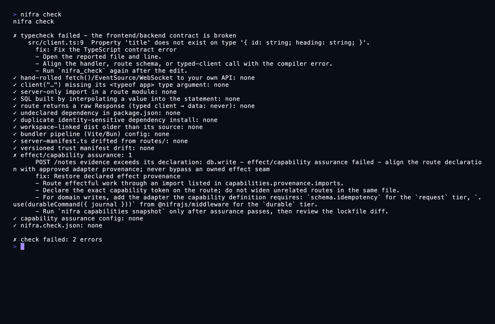

<p align="center">
  <a href="https://nifra.dev"></a>
</p>

<h1 align="center">Nifra</h1>

<p align="center"><b>The AI-native TypeScript framework.</b><br>
Typed APIs and full-stack SSR on five UI libraries, one app across Bun, Node, Deno, and the edge -<br>
built so both humans and coding agents can change it safely.</p>

<p align="center">
  <a href="https://www.npmjs.com/package/@nifrajs/core"></a>
  <a href="https://www.npmjs.com/package/@nifrajs/core"></a>
  <a href="https://github.com/nifrajs/nifra/actions/workflows/ci.yml"></a>
  <a href="https://bun.sh">= 1.3"></a>
  <a href="LICENSE"></a>
</p>

<p align="center">
  <a href="https://nifra.dev/docs">Documentation</a> ·
  <a href="https://nifra.dev/play">Playground</a> ·
  <a href="examples">Examples</a> ·
  <a href="https://nifra.dev/benchmarks">Benchmarks</a> ·
  <a href="https://nifra.dev/docs/comparison">vs. other frameworks</a>
</p>

<p align="center">
  
  <br>
  <sub><code>nifra check</code> catches a broken contract and an undeclared effect, and says how to fix both.</sub>
</p>

---

Nifra is a TypeScript framework for typed APIs and full-stack SSR. Define a route once and the client,
the validation, and the agent tools all follow from it. A coding agent gets a live, checkable view of
your project instead of stale docs.

## Quick start

```sh
bun create nifra my-app # scaffold the API starter
cd my-app
bun install
bun run dev
```

For a full-stack React app with SSR:

```sh
bun create nifra my-app --template site --framework react
```

Or add a backend to an existing project:

```sh
bun add @nifrajs/core @nifrajs/schema @nifrajs/client
```

## Typed end to end, no codegen

```ts
import { server } from "@nifrajs/core/server"
import { t } from "@nifrajs/schema"

export const app = server()
  .get("/users/:id", (c) => ({ id: c.params.id }))
  .post("/users", { body: t.object({ name: t.string() }) }, (c) => ({
    id: crypto.randomUUID(),
    name: c.body.name,
  }))
```

The client is inferred from the server type - no codegen, no duplicated schema, no stale SDK:

```ts
import { client } from "@nifrajs/client"
import type { app } from "./server"

const api = client<typeof app>("http://localhost:3000")
const result = await api.users({ id: "42" }).get()

if (result.ok) result.data.id   // route return type, checked by tsc
else result.error               // failures are returned, never thrown
```

Change a route and every caller stops compiling until it is updated. Add loaders, actions, streaming,
`defer()`/`<Await>`, islands, query cache, progressive-enhancement forms, and server functions when
the app grows. The same web layer runs on React, Vue, Solid, Svelte, or Preact.

## Work with your coding agent

Register Nifra once and an agent can inspect the actual project, fetch version-checked examples and
types, scaffold in the correct route directory, run HTTP/SSR/WebSocket checks, inspect recent requests,
and loop on structured fixes:

```sh
claude mcp add nifra -- bunx @nifrajs/cli mcp
```

`bun create nifra` installs `@nifrajs/cli` as a dev dependency, so inside the project `bunx nifra`
runs the local copy:

```sh
bunx nifra init-agents

bunx nifra context       # live route and convention map
bunx nifra check         # typecheck, drift, and bundle-boundary gate
bunx nifra assure        # route security evidence gate
bunx nifra levels        # cumulative proof level and next missing rung
bunx nifra smoke         # real SSR, API, auth and hydration requests against the build
```

`nifra smoke` reads a fixture from `nifra.smoke.ts` (or `--fixture <file>`) that configures SSR; the
auth and hydration checks run only when the fixture supplies them. See the
[CLI reference](https://nifra.dev/docs/cli).

The local server runs where your code lives - your source never reaches Nifra. The teaching tools are
also hosted at [`mcp.nifra.dev`](https://mcp.nifra.dev) for agents that only need the verified Nifra
corpus. Skills are available for [Pi](packages/skills) and [Claude Code](packages/skills).

## Start from an example

| Example | Shows |
|---|---|
| [`web-react`](examples/web-react) | Full-stack SSR with hydration on React |
| [`routing-react`](examples/routing-react) | File-based routing, nested layouts, params |
| [`live-react`](examples/live-react) | Live refresh across every open tab |
| [`server-components`](examples/server-components) | Server components |
| [`auth-react`](examples/auth-react) | Authentication on a full-stack app |
| [`portable-ssr-react`](examples/portable-ssr-react) | One app on Cloudflare, Node, Deno, and Vercel Edge |
| [`workers`](examples/workers) | A backend on Cloudflare Workers |
| [`webmcp`](examples/webmcp) · [`mcp-app`](examples/mcp-app) | Page-local agent tools and MCP Apps |

The full list, with single-file examples, is in [`examples/`](examples).

## What the web layer adds

- [**Live refresh**](https://nifra.dev/docs/live) - a loader names the keys it read with `live(...)`; a publish reloads only those loaders on every open tab, through the same middleware, gates and loaders a navigation runs.
- [**Partial prerendering**](https://nifra.dev/docs/partial-prerendering) - the part of a page every visitor shares is served from a cache at once, and each per-visitor hole streams in as its loader settles.
- [**Server components**](https://nifra.dev/docs/server-components) on all five adapters - React RSC/Flight, and native server-rendered ranges for the others.
- [**Keep-alive**](https://nifra.dev/docs/keep-alive) - back and forward bring a page back with its state, scroll and focus.
- **SSG and ISR** with tag purges that clear data caches, the page store, live pages and the CDN in order, so a writer reads its own write.

## One contract. Every surface.

Nifra is for software that is **built, operated, and used with agents in the loop**. An agent should
discover the real contract, call typed capabilities, stream progress into the UI, ask for approval at
the right boundary, update state optimistically, reconcile with the server, and leave evidence that the
work actually happened. Nifra makes that one system:

- **Build surface:** typed APIs, runtime schemas, a no-codegen client, full-stack SSR, and one app across five UI libraries and five runtimes.
- **Agent surface:** page-local WebMCP, remote MCP/MCP Apps, A2A, and AG-UI from the same capability and tool contracts.
- **Execution surface:** bounded agent turns, budgets, approvals, idempotency, cancellation, resumable evidence, and provider-neutral model ports.
- **UI surface:** deterministic predictive UI, shared run state, streamed deltas, human-in-the-loop decisions, content-free browser views, and Run Studio.
- **Proof surface:** live MCP project context plus typecheck, route assurance, effect provenance, manifests, and contract-derived verification gates.

Define the capability once, then project it to the surface that fits the moment. A page-local agent can
use WebMCP while the page is open; a background agent can use remote MCP; another agent can use A2A; a
human-facing client can consume AG-UI. They still meet the same typed validation, authorization,
approval, output, and evidence boundary.

```ts
import { t } from "@nifrajs/schema"
import { defineAgentCapability, registerWebMcpTools } from "@nifrajs/webmcp"

export const addToCart = defineAgentCapability({
  name: "cart.add",
  description: "Add a product to the current cart.",
  input: t.object({ sku: t.string(), quantity: t.number() }),
  output: t.object({ cartVersion: t.string() }),
  writes: ["cart"],
  execute: (input) => addItemOnTheServer(input),
  predict: ({ input, version }) => ({
    baseVersion: version,
    patch: [{ op: "add", path: "/items/-", value: input }],
  }),
  reconcile: ({ previous, input, output }) => ({
    state: { items: [...previous.state.items, input] },
    version: output.cartVersion,
  }),
})

// Explicit page-local discovery. Unsupported hosts receive a safe no-op report.
await registerWebMcpTools([addToCart])
```

The same `addToCart.tool` can be projected into Nifra's remote MCP adapter or called by an agent
runner. Predictions are deterministic application code - not LLM guesses - and commit, rollback, conflict,
expiry, and authoritative reconciliation are explicit outcomes.

See the [WebMCP and predictive UI guide](https://nifra.dev/docs/webmcp) and the
[agent layer](https://nifra.dev/docs/agents).

## Agentic backend: bounded, typed, observable

Nifra also provides the runtime for applications whose product is an agent. The model provider,
credentials, durable state, tenancy, and policy are injected ports; the framework owns the safety and
execution semantics around them.

```ts
import { createAgentState, runAgent } from "@nifrajs/agent"

const result = await runAgent(definition, { value: input }, ports, {
  state: createAgentState("support-1"),
  maxTurns: 8,
})
```

You get typed tool contracts, bounded turns and budgets, approvals, cancellation, idempotency,
resumable token-only evidence, model/token streaming, transient shared state, and composable
telemetry. A failed post-turn gate can become a bounded repair turn in the standalone
`nifra-agent` host.

## Agentic UI: from intent to visible state

The UI is not an afterthought. Nifra gives an agent several deliberate ways to interact with an app:

| Surface | Best for | Nifra's contract |
|---|---|---|
| **WebMCP** | An agent acting in the currently open page | Explicit tool allowlists, typed inputs/outputs, bounded receipts, deterministic prediction, versioned reconciliation |
| **MCP / MCP Apps** | Remote tools, background work, and rich tool results | The same core tool projected to remote MCP and `ui://` widgets |
| **AG-UI** | Streaming an agent run into a product UI | SSE lifecycle, text/reasoning/tool deltas, shared-state snapshots/deltas, resumable evidence, typed resume |
| **Agent App / Workbench** | Browser and desktop control planes | Negotiated features, approvals, handoffs, decision inbox, capability registry, Run Studio |

For a predictive interaction, the application supplies a pure patch and a reconciliation rule. The
store applies it atomically, then either accepts authoritative server state or reports rollback,
conflict, or expiry. The human UI remains fully functional when no agent host is present.

## Interoperate without rewriting the agent

The runner is the center; protocol adapters are edges:

- [`@nifrajs/mcp`](packages/mcp) exposes tools and MCP Apps.
- [`@nifrajs/webmcp`](packages/webmcp) exposes explicit page-local tools and predictive UI.
- [`@nifrajs/a2a`](packages/a2a) mounts an A2A 1.0 card plus JSON-RPC/SSE.
- [`@nifrajs/ag-ui`](packages/ag-ui) mounts AG-UI events over SSE.
- [`@nifrajs/agent-app`](packages/agent-app) provides a backend-neutral browser client.
- [`@nifrajs/coding-agent`](packages/coding-agent), [`@nifrajs/agent-protocol`](packages/agent-protocol), and [`@nifrajs/pi`](packages/pi) provide a standalone coding-agent host; [`@nifrajs/acp`](packages/acp) drives any Agent Client Protocol agent through it.

## Proof, not promises

Agentic systems need more than “the model said it worked.” Nifra turns the important claims into gates:

```sh
bunx nifra check
bunx nifra assure
bunx nifra capabilities check
bunx nifra manifest diff
bunx nifra levels --min 1
```

- `nifra check` catches type drift, raw calls around the typed client, server-only bundle leaks, and other contract violations.
- `nifra assure` classifies the live route graph and fails when required authentication, validation, rate limiting, CSRF, or body-cap evidence is missing.
- `nifra capabilities check` compares declared effect tokens with the module graph and a reviewed lockfile.
- `nifra manifest diff` detects contract, assurance, effect, and response-sensitivity changes at promotion time.
- `nifra levels` reports the highest cumulative proof level a project actually holds, from typed contract to contract-derived invariant tests.

Docs and examples are compiled against the live API, and the machine-readable MCP corpus is generated
from built packages. An agent gets a repairable diagnostic instead of a stale suggestion.

## Full-stack portability, without the framework tax

The app lifecycle is `app.fetch(Request): Promise<Response>`. Define it once and deploy to Bun, Node,
Deno, Cloudflare Workers/Pages, or Vercel Edge with a small adapter. The web layer supports React,
Vue, Solid, Svelte, and Preact without changing the route/data model.

The published snapshot in [`site/shared/data/benchmarks.json`](./site/shared/data/benchmarks.json) is the source
of truth for the website tables and benchmark comparison articles. The benchmark suites merge fresh
results into it through [`bench/site-bench.ts`](./bench/site-bench.ts). The public tables include
rows where Nifra loses and keep bare HTTP, middleware-shaped HTTP, dynamic SSR, and cacheable SSR
results separate.

See [benchmark methodology and full results](https://nifra.dev/benchmarks), and run
`bun run bench:http` / `bun run bench:ssr` yourself.

## Limits to know

- The local process and extension agent adapters contain crashes and accidents; they are not hostile-code sandboxes.
- Every protocol boundary still needs application authentication and authorization. Public reference adapters keep credentials, durable storage, tenant state, and operated policy outside the package so you can supply the right implementation for your deployment.

## Batteries (59 packages, all typed, all optional)

<details>
<summary>Package map by job</summary>

| Layer | Packages |
|---|---|
| Backend | [`core`](packages/core) · [`schema`](packages/schema) · [`client`](packages/client) · [`middleware`](packages/middleware) |
| Full-stack web | [`web`](packages/web) · [`web-react`](packages/web-react) · [`web-vue`](packages/web-vue) · [`web-solid`](packages/web-solid) · [`web-svelte`](packages/web-svelte) · [`web-preact`](packages/web-preact) · [`web-vanilla`](packages/web-vanilla) · [`cache`](packages/cache) · [`i18n`](packages/i18n) · [`image`](packages/image) · [`content`](packages/content) |
| Runtimes | [`node`](packages/node) · [`deno`](packages/deno) · [`edge`](packages/edge) · [`workers`](packages/workers) · [`aws-lambda`](packages/aws-lambda) · [`deploy-fly`](packages/deploy-fly) |
| Agent runtime | [`agent`](packages/agent) · [`prompt`](packages/prompt) · [`runner`](packages/runner) · [`agent-telemetry`](packages/agent-telemetry) |
| Agent UI and protocols | [`webmcp`](packages/webmcp) · [`agent-app`](packages/agent-app) · [`mcp`](packages/mcp) · [`a2a`](packages/a2a) · [`ag-ui`](packages/ag-ui) |
| Coding agents | [`coding-agent`](packages/coding-agent) · [`agent-protocol`](packages/agent-protocol) · [`pi`](packages/pi) · [`acp`](packages/acp) · [`skills`](packages/skills) |
| App services and quality | [`auth`](packages/auth) · [`better-auth`](packages/better-auth) · [`authjs`](packages/authjs) · [`jobs`](packages/jobs) · [`cron`](packages/cron) · [`storage`](packages/storage) · [`uploads`](packages/uploads) · [`testing`](packages/testing) · [`e2e`](packages/e2e) · [`mock`](packages/mock) · [`otel`](packages/otel) |
| Supporting surfaces | [`env`](packages/env) · [`events`](packages/events) · [`graphql`](packages/graphql) · [`island-trigger`](packages/island-trigger) · [`mcp-db`](packages/mcp-db) · [`nifra`](packages/nifra) · [`proxy`](packages/proxy) · [`agent-review`](packages/agent-review) |
| Tooling | [`cli`](packages/cli) · [`create-nifra`](packages/create-nifra) · [`devtools`](packages/devtools) · [`ts-plugin`](packages/ts-plugin) |

</details>

All packages are optional and typed. Start with the core, then add only the surfaces your product
needs. [Browse the complete documentation](https://nifra.dev/docs).

## Develop

```sh
bun install
bun run check          # lint, typecheck, tests, docs, corpus, and size gates
bun run build          # emit dist/ for all packages
bun run bench:http     # reproducible HTTP matrix
```

Contributions welcome - see [CONTRIBUTING.md](CONTRIBUTING.md). MIT licensed.
